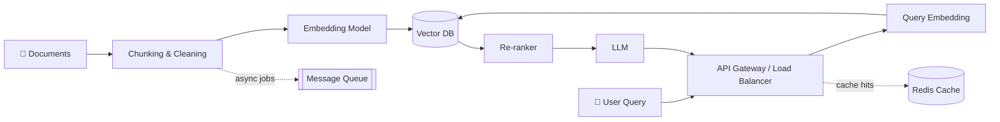
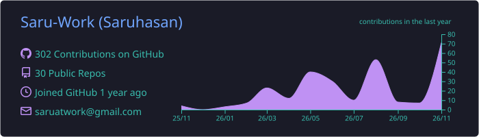
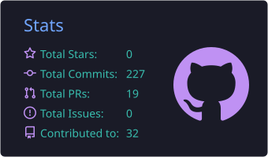
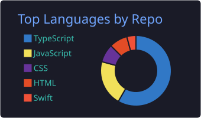
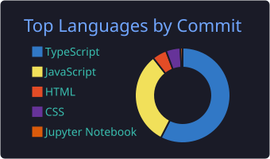
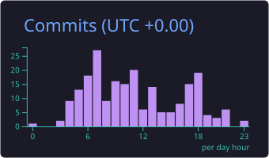

<!-- ═══════════════════════════ HEADER ═══════════════════════════ -->
<div align="center">


<br/>

<a href="https://github.com/Saru-Work"></a>
<a href="https://linkedin.com/in/saruhasan-thavachelvan"></a>
<a href="mailto:saruatwork@email.com"></a>


</div>

<br/>

## `01 / ABOUT ME`


I'm a **Full Stack Developer** from Sri Lanka 🇱🇰 who loves going beyond "it works" to **"it scales."**
I enjoy designing systems that stay fast and reliable under load — and lately I've been
pairing that with **AI engineering**, building **Retrieval-Augmented Generation (RAG)** pipelines
that ground LLMs in real data.

- 🏗️ Designing **highly scalable, distributed systems** — caching, queues, sharding, fault tolerance
- 🤖 Exploring **AI Engineering** — LLM apps, embeddings, vector search & **RAG pipelines**
- 💻 Shipping full-stack products with **Next.js, React, Node.js, FastAPI & TypeScript**
- ☁️ Learning **Docker, CI/CD & cloud infrastructure** to take projects to production
- 🎓 Undergraduate at **Sabaragamuwa University of Sri Lanka**

<br clear="right"/>

```typescript
const saruhasan = {
  role: "Full Stack Developer",
  university: "Sabaragamuwa University of Sri Lanka",
  interests: [
    "System Design",
    "Highly Scalable Distributed Systems",
    "AI Engineering",
    "RAG (Retrieval-Augmented Generation)",
  ],
  currentlyBuilding: ["RAG pipelines", "Scalable backend services"],
  currentlyLearning: ["LLM orchestration", "Vector databases", "Docker & CI/CD", "Cloud infra"],
  motto: "Build. Break. Learn. Improve.",
};
```

---

## `02 / WHAT I'M INTO`

<table>
<tr>
<td width="33%" valign="top">

### 🏗️ System Design
Load balancing, caching layers, message queues, database sharding & replication, rate limiting, and designing for failure.

</td>
<td width="33%" valign="top">

### 🤖 AI Engineering
LLM-powered applications, prompt design, embeddings, evaluation, and integrating models into real products.

</td>
<td width="33%" valign="top">

### 🔎 RAG Systems
Document ingestion, chunking, vector search, hybrid retrieval, re-ranking and grounded generation — built to scale.

</td>
</tr>
</table>

### 🧠 How I think about a scalable RAG system



---

## `03 / TECH STACK`

<div align="center">

**Frontend**<br/>


**Backend**<br/>


**Databases & Caching**<br/>


**DevOps, Cloud & Tools**<br/>


**AI / ML & RAG**<br/>


</div>

---

## `04 / FEATURED PROJECTS`

<table>
<tr>
<td width="50%" valign="top">

### 🚀 HallSync
**Smart Lecture Hall Management**

Faculty-level lecture hall management and smart scheduling system.

- 📅 Lecture creation & scheduling
- 🔁 Timetable management & rescheduling
- 🔐 Role-based access (Admin / Lecturer / Student)
- 🔔 Department-specific notifications


</td>
<td width="50%" valign="top">

### 💍 Viwahaa
**Matrimony Platform**

Full-stack matrimony platform with membership management and admin workflows.

- 💳 Membership & subscription management
- 🖼️ Profile & image management
- 📊 Admin dashboard
- ✅ Payment & verification workflows


</td>
</tr>
</table>

---

## `05 / GITHUB ANALYTICS`

<!-- These cards are generated inside this repo by .github/workflows/profile-summary-cards.yml,
     so they never depend on a rate-limited public server. -->

<div align="center">









</div>

---

## `06 / CONTRIBUTION ACTIVITY`

<div align="center">
<picture>
  <source media="(prefers-color-scheme: dark)" srcset="https://raw.githubusercontent.com/Saru-Work/Saru-Work/output/github-contribution-grid-snake-dark.svg" />
  
</picture>
</div>

---

## `07 / CURRENT FOCUS`

| Area | Focus |
|:---|:---|
| 🏗️ **System Design** | Highly scalable & distributed systems, microservices, fault tolerance |
| 🤖 **AI Engineering** | LLM-powered apps, embeddings, evaluation |
| 🔎 **RAG** | Retrieval pipelines, vector search, re-ranking, grounding at scale |
| ⚙️ **Backend Engineering** | API design, caching, queues, database performance |
| 💻 **Full Stack** | Production-ready apps with Next.js, React & Node.js |
| ☁️ **DevOps & Cloud** | Docker, CI/CD, AWS & automation |

---

## `08 / LET'S CONNECT`

<div align="center">

**Open to collaborating on scalable backends, AI/RAG systems, or anything ambitious. Let's build something!**

<a href="https://github.com/Saru-Work"></a>
<a href="https://linkedin.com/in/saruhasan-thavachelvan"></a>
<a href="mailto:saruatwork@email.com"></a>

<br/><br/>


</div>
